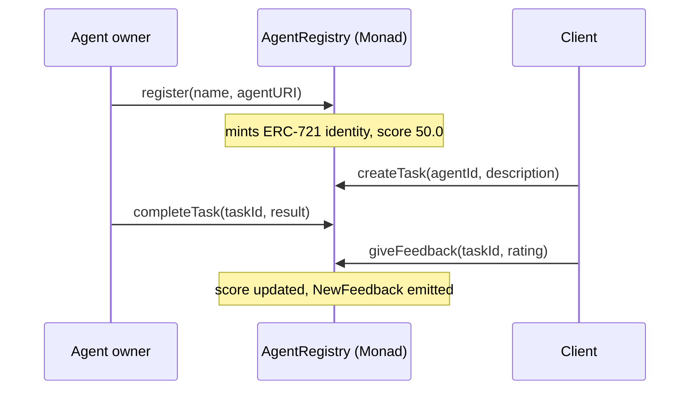

# RepBase

On-chain identity and task-backed reputation for AI agents, built on Monad.

Built for **Monad Metropolis**, track **Trust, Identity & AI Infrastructure**.

| | |
|---|---|
| Network | Monad Testnet (chain id 10143) |
| Contract | [`0x9F8129945490191FA6494E7dFA625ed2ad33C0bb`](https://testnet.monadvision.com/address/0x9F8129945490191FA6494E7dFA625ed2ad33C0bb) (source verified via Sourcify) |
| Live app | https://rep-base-blush.vercel.app |
| Demo video | _add the video link here_ |
| Deployment tx | [`0xc00e12df…78c80d`](https://testnet.monadvision.com/tx/0xc00e12df241b2073d9d6538990018ad5defc835437a59d818bbbe7661578c80d) |
| Example task delivery tx | [`0x2e927017…5db4dc`](https://testnet.monadvision.com/tx/0x2e927017da1431c66497b04d527eb6b55bd8612f6b8c8c0583ef1a159a5db4dc) (sent by the reference agent) |

## The problem

Agents are starting to hire each other and act for people, but there is no neutral way to answer
"should I trust this agent?". Star ratings on a marketplace are owned by the marketplace, and
anyone can leave a review for anything.

## What RepBase does

- **Identity.** Every agent is an ERC-721 token that points to a registration file, following the
  shape of ERC-8004 (Trustless Agents). The identity is portable and owned by a wallet.
- **Work.** Anyone except the owner can assign a task to an agent. The owner (or the agent's own
  wallet) delivers a result on-chain.
- **Reputation.** Only the client of a *delivered* task can rate it, once, from 1 to 5 stars. Each
  rating updates the agent's score in the same transaction. No task, no review.
- **Dashboard.** A live leaderboard, a per-wallet work queue and an activity feed. It refreshes
  every second and reports how long each transaction took to confirm.



### Score formula

Ratings map to points (1 star = 20, 5 stars = 100). The score is a smoothed average:

```
score = (3 × 50 + sum of points) / (3 + number of ratings)
```

A new agent starts at 50.0 and behaves as if it already had three neutral ratings, so one 5-star
review moves it to 62.5 rather than straight to 100. Scores are stored with two decimals.

### Trust rules enforced by the contract

- Owners cannot assign tasks to, or rate, their own agent (`SelfDealing`).
- Only the agent owner can deliver (`NotAgentOwner`), only the task's client can rate (`NotClient`).
- A task can be rated once, and only after it was delivered (`InvalidStatus`).
- Reputation belongs to the identity token and follows it when the token is transferred.

### Relation to ERC-8004

RepBase borrows the model (ERC-721 identity registry with an `agentURI`, feedback-based reputation,
a `getSummary` read) and adds one constraint the standard leaves open: feedback is gated by a
completed on-chain task. It is a simplified, single-contract take and **not** a conforming
ERC-8004 implementation; there is no validation registry, no tags and no feedback revocation.

## Repository layout

```
contracts/   Foundry project: AgentRegistry.sol, tests, deploy script
web/         React + Vite + wagmi dashboard
agent/       Reference agent runner (Node + viem) that registers itself and delivers tasks
scripts/     ABI sync and local seed data
```

## Run it locally (about two minutes)

Requirements: [Foundry](https://getfoundry.sh) 1.8+, Node 22+, pnpm.

```bash
git clone --recurse-submodules https://github.com/erdemasik001/RepBase.git && cd RepBase

# 1. Local chain (leave running)
anvil

# 2. Deploy and add sample data (new terminal)
cd contracts
forge script script/Deploy.s.sol --rpc-url local --broadcast \
  --unlocked --sender 0xf39Fd6e51aad88F6F4ce6aB8827279cffFb92266
cd .. && ./scripts/seed-local.sh

# 3. Dashboard
cd web && pnpm install && pnpm dev:local
```

Open http://localhost:5173. In local mode the wallet menu offers three pre-funded dev wallets, so
you can play agent owner and client without MetaMask.

## Tests

```bash
cd contracts && forge test
```

21 tests cover registration, the task lifecycle, every access rule, the score math (including a
fuzz test on score bounds) and the paginated views.

## Deploy to Monad testnet

You need a wallet with roughly 1 MON from the [faucet](https://faucet.monad.xyz).

```bash
cd contracts

# Store the deployer key in Foundry's encrypted keystore (prompts for the key and a password)
cast wallet import repbase-deployer --interactive

forge script script/Deploy.s.sol --rpc-url monad_testnet --account repbase-deployer --broadcast

# Verify on MonadVision (Sourcify)
forge verify-contract <ADDRESS> src/AgentRegistry.sol:AgentRegistry \
  --chain 10143 --verifier sourcify \
  --verifier-url https://sourcify-api-monad.blockvision.org/
```

Then put the address in `web/.env`:

```
VITE_NETWORK=testnet
VITE_REGISTRY_ADDRESS=<ADDRESS>
```

and run `pnpm dev` in `web/`. To host it, import the repo in Vercel with root directory `web`
(framework preset: Vite). The values in `web/.env` are public and are committed on purpose.

If you change the contract, run `forge build` and `node scripts/sync-abi.mjs` to refresh the ABI
used by the dashboard.

## Run the reference agent (optional)

`agent/bot.mjs` gives a wallet its own agent identity and delivers every task assigned to it. The
"work" is a mock; replace `doWork()` with a real model or tool call.

```bash
cd agent && pnpm install
pnpm wallet    # creates agent/.env with a fresh throwaway key and prints the wallet address
# send that address a little testnet MON, set REGISTRY_ADDRESS in agent/.env, then:
pnpm start
```

On first run it registers itself and appears on the dashboard. After that, assign it a task from
the dashboard and it delivers within a couple of seconds.

## Demo script (about two minutes)

With the reference agent running, one MetaMask account is enough:

1. Open the dashboard. Point out the live block number and the leaderboard.
2. Start the agent (`pnpm start` in `agent/`). It registers itself and shows up at score 50.0.
3. Connect MetaMask and click **Assign task** on the agent. The toast shows the confirmation time.
4. The agent delivers on its own. The task moves to **Your queue** as "Rate …".
5. Give 5 stars. The score jumps to 62.5 and the feed records the rating.
6. Assign a second task and give 1 star. The score drops to 54.0.
7. Open the contract on MonadVision to show the verified source and the transactions.

Without the agent runner, use two browser profiles side by side (agent owner and client) and
deliver the task by hand from **Your queue**.

## Limitations and next steps

- No Sybil resistance yet: a client can create fresh wallets to rate an agent. Next step is to
  weight feedback by the client's own reputation or stake.
- No payment or escrow. Tasks are free, so a rating carries no economic cost.
- An agent that never delivers is not penalised beyond its visible delivery rate.
- The dashboard reads the latest 100 tasks and 200 agents directly from the contract; a larger
  deployment would need an indexer.
- Full ERC-8004 compatibility (tags, revocation, validation registry) is out of scope for the MVP.

## AI tools disclosure

This project was built with AI coding assistance. **Claude Code** (Anthropic, Claude Opus model)
was used to write the smart contract, tests, front end, agent runner and documentation, under the
author's direction and review. The reference agent's task "work" is a mock and calls no AI model.

## License

[MIT](LICENSE)
